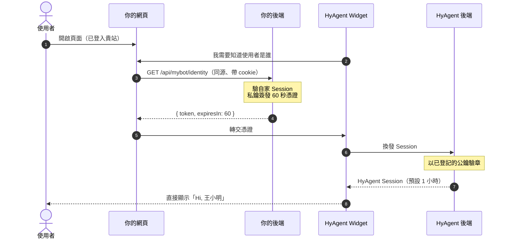

# HyAgent 自動登入 — 客戶端整合手冊

| 項目 | 內容 |
| --- | --- |
| 適用對象 | 要把 HyAgent Widget 嵌進自家網站，並讓已登入的使用者**免再登入一次**的開發團隊 |
| 你需要動到的部分 | 一組金鑰對、後端一支 API、前端一行 `<script>`，以及登出時通知 Widget 的一小段程式 |
| 預估工作量 | 半天～一天（含測試） |
| 完整規範 | [HyAgent客戶網站自動登入規格.md](HyAgent客戶網站自動登入規格.md)。本手冊是它的操作摘要，兩者若有出入**以規格為準** |

---

## 1. 你要做的事

| # | 做什麼 | 誰做 | 頻率 |
| --- | --- | --- | --- |
| 1 | 產生一組金鑰對，**公鑰**交給 HyAgent 登記，**私鑰**自己留著 | 維運 / 後端 | 導入一次，之後約每年輪替 |
| 2 | 後端開一支 **Identity Endpoint**，用私鑰簽發 60 秒短效憑證 | 後端 | 主要工作 |
| 3 | 前端貼一行 `<script>` | 前端 | 5 分鐘 |
| 4 | 使用者**登出**貴站時，先呼叫 `OAAgent.logout()` 再導頁 | 前端 | 照抄 §5.3，約 10 分鐘 |
| 5 | 使用者**不經登出直接切換帳號**時，呼叫 `OAAgent.refreshIdentity()`。**貴站若無此功能可忽略** | 前端 | 見 §5.4 |

驗章、建立 Session、憑證續期都由 HyAgent 與 Widget 自動處理，**你不需要寫**。

第 4、5 件沒辦法自動：Widget 看不到貴站的登入狀態，使用者登出或換人只有貴站知道。漏掉第 4 件，
使用者登出貴站之後小幫手裡仍是上一位，直到 Session 自然過期——共用電腦上那正是登出要防的情境。

第 5 件指的是代理人、客服代操作這類「不登出就換成另一位」的功能。一般網站的換人是
「登出 → 回登入頁以另一位登入」，第 4 件就已涵蓋。

---

## 2. 為什麼不能直接把使用者資料傳給 Widget

Widget 是跨網域的 iframe，讀不到貴站的 Cookie 或登入 Session，所以它必須「被告知」目前是誰。但下面這種寫法等於沒有認證——前端 JS 任何人都能改：

```js
// ❌ 絕對不可以
OAAgent.setUser({ userId: "123", email: "user@example.com" });
```

正確做法是**由你的後端用私鑰簽一張有簽章的短效憑證**（Identity Assertion），前端只負責轉交，HyAgent 用你事先登記的公鑰驗章。憑證被中途改一個字就會驗章失敗。



**私鑰永遠不離開貴方環境**，HyAgent 手上只有公鑰——因此 HyAgent 也沒有能力偽造貴方任何一位使用者。

---

## 3. 前置準備

### 3.1 跟 HyAgent 要這三樣

| 項目 | 範例 | 用途 |
| --- | --- | --- |
| **Tenant ID** | `a3f19c2d84b7e061` | 憑證的 `iss` 欄位要填它 |
| **HyAgent 服務網址** | `https://{hyagent-host}` | 載入 widget.js、CSP 放行 |
| **公開金鑰 `pk_…`** | `pk_xxxxxxxx` | 前端 `data-key`，決定外觀設定與 CORS（**不是**密碼，可公開） |

### 3.2 產生金鑰對（在你自己的機器上）

HyAgent 會提供一支單檔工具 `hyagent-keygen.mjs`，**零相依、不需 npm install**，Node.js 18 以上即可：

```bash
node hyagent-keygen.mjs ES256 ./keys
```

輸出：

```text
{ "alg": "ES256", "kid": "JIyMfVT7Az-6tEPXT8S10ZIdKL7K_nhi9WEqsiqdYI8" }
-----BEGIN PUBLIC KEY-----
...
-----END PUBLIC KEY-----

已寫入：
  ./keys/hyagent-JIyMfVT7Az….public.pem    ← 上傳 HyAgent
  ./keys/hyagent-JIyMfVT7Az….private.pem   ← 自行保管，絕不外流
```

| 選項 | 說明 |
| --- | --- |
| 演算法 | `ES256`（**建議**，憑證較短、簽得較快）或 `RS256`（RSA，modulus 須 ≥ 2048） |
| `--modulus <bits>` | RS256 的金鑰長度，預設 2048 |
| `--kid <public.pem>` | 只計算既有公鑰的 `kid`，不產生新金鑰。**與 HyAgent 後台對帳時很好用** |

已有 PKI / HSM 流程的話也可以用 OpenSSL 自行產生，再用 `--kid` 算出指紋核對：

```bash
# ES256
openssl genpkey -algorithm EC -pkeyopt ec_paramgen_curve:P-256 -out private.pem
openssl pkey -in private.pem -pubout -out public.pem
node hyagent-keygen.mjs --kid public.pem
```

> `kid` 是公鑰的指紋（RFC 7638 JWK Thumbprint），由公鑰本身算出。你算的和 HyAgent 後台顯示的**必然相同**；對不起來就代表傳錯檔案了。

### 3.3 交給 HyAgent 登記

| 要給的 | 說明 |
| --- | --- |
| **公鑰 PEM** | `-----BEGIN PUBLIC KEY-----` 開頭那個檔。**千萬不要傳成 private.pem** |
| **Allowed Origins** | 所有會嵌入 Widget 的網域，**含測試環境**（例：`https://oa.example.com`、`https://uat.example.com`）。不在名單內的網域一律被拒 |
| （選）Session 有效期 | 預設 3600 秒，可設 300～28800。**建議不要長於貴站自己的 session**，否則會出現「貴站已登出、Widget 還是登入狀態」的空窗 |

### 3.4 私鑰保管（硬性要求）

| 要求 | 內容 |
| --- | --- |
| 只放後端 | **不得**進入前端程式碼、版控、日誌、錯誤回報，或任何瀏覽器碰得到的地方 |
| 檔案權限 | 以檔案保存時設為 `0600`（Windows 用 NTFS ACL 限制）；**建議**改放 KMS / Vault / 環境變數 |
| 上線前 | 以 gitleaks 之類的工具掃一次 repo |

---

## 4. 後端：Identity Endpoint（主要工作）

### 4.1 契約

```text
GET /api/mybot/identity      ← 路徑可自訂，前端 data-token-url 要對應
```

| 項目 | 規範 |
| --- | --- |
| 身分來源 | **一律以貴站自家的登入 Session（Cookie / Bearer）判定**。**絕不可**接受前端傳進來的 user id、email 等身分參數 |
| 未登入 | 回 `401`，且**不簽發**憑證 |
| 成功 | `200` + `Content-Type: application/json` |
| 必要標頭 | `Cache-Control: no-store`（憑證被 CDN 或瀏覽器快取＝機敏資料外洩） |
| CSRF | 是 GET、不改狀態，但**建議**要求 `Sec-Fetch-Site: same-origin` 或自訂 header |
| 速率限制 | **建議**每使用者 60 次/分鐘（正常用量遠低於此：一小時的 Session 只續期一次） |

回應格式：

```json
{ "token": "eyJhbGciOiJFUzI1NiIsInR5cCI6IkpXVCIsImtpZCI6...", "expiresIn": 60 }
```

> **這支端點會被重複呼叫**：面板第一次要身分時、Session 到期前 60 秒、收到 401 時各一次。它**必須每次都回傳當下新簽的憑證**，不可快取重用——重複使用的憑證會被 `TOKEN_REPLAYED` 拒絕。

### 4.2 Node.js：用 SDK 簽（最省事）

```js
import express from "express";
import { readFileSync } from "node:fs";
import { issueAssertion } from "@hyagent/sdk/server";

const app = express();
const PRIVATE_KEY = readFileSync(process.env.HYAGENT_PRIVATE_KEY_PATH, "utf8");
const TENANT = process.env.HYAGENT_TENANT;   // 例：a3f19c2d84b7e061

app.get("/api/mybot/identity", (req, res) => {
  // ① 身分只取自自家 Session，絕不取自 query / body / header
  const user = req.session?.user;
  if (!user) return res.status(401).json({ error: "NOT_AUTHENTICATED" });

  // ② 簽 60 秒憑證；alg / kid / jti 由 SDK 自動處理
  const token = issueAssertion({
    privateKey: PRIVATE_KEY,
    tenant: TENANT,
    subject: user.id,                 // 穩定、不重複配發的內部 ID
    lifetimeSeconds: 60,
    profile: {
      name: user.displayName,
      email: user.email,
      roles: user.roles,
      "hyagent:profile": {            // 自家組織欄位放這裡
        companyId: user.companyId,
        deptId: user.deptId,
        deptName: user.deptName,
      },
    },
  });

  // ③ 絕不可被快取
  res.set("Cache-Control", "no-store");
  res.json({ token, expiresIn: 60 });
});
```

可執行的完整範例（含模擬登入與嵌入頁）在 `presale/widge-tenant/`，照它的 README 跑一遍最快。

### 4.3 其他語言：自行簽發 JWT

憑證就是一張標準 JWS（JWT），用貴方語言既有的 JOSE 函式庫即可：Java 用 Nimbus JOSE+JWT、Python 用 `authlib` / `python-jose`、.NET 用 `Microsoft.IdentityModel.Tokens`、PHP 用 `firebase/php-jwt`。

**Header**

| 欄位 | 值 |
| --- | --- |
| `alg` | `RS256` 或 `ES256`，須與登記公鑰時宣告的一致 |
| `typ` | 固定 `JWT` |
| `kid` | §3.2 算出的那串（`--kid` 或後台顯示值） |

> **不得**加入 `jku` / `jwk` / `x5u` / `x5c`，帶了會直接被拒。

**Payload（必要）**

| Claim | 值 | 備註 |
| --- | --- | --- |
| `iss` | 你的 Tenant ID | HyAgent 靠它決定是哪個客戶 |
| `sub` | 使用者在貴站的唯一 ID | **穩定、不可重複配發**；離職者的 ID 不可給新人，否則會繼承其對話紀錄 |
| `aud` | 固定字串 `hyagent` | 所有客戶都一樣，**不要**放自己的識別 |
| `iat` | 現在時間（Unix 秒） | |
| `exp` | `iat + 60` | 最大 300 秒，超過即不合契約 |
| `jti` | **每次都不同**的唯一值 | UUIDv4 即可。重複會被擋成重放 |

**Payload（選填）**

| Claim | 型別 | 說明 |
| --- | --- | --- |
| `name` | string | 顯示名稱，Widget 用來稱呼使用者 |
| `email` | string | |
| `picture` | string | 必須是 `https://` |
| `roles` | string[] | 供 HyAgent 端授權、知識庫範圍控制 |
| `locale` | string | 例 `zh-TW` |
| `hyagent:profile` | object | 自家組織欄位（部門、公司、職稱…）集中放這裡；或用自訂短前綴如 `hyoa_deptId` |

其中這四個會被 HyAgent 採用為使用者身分，並顯示在 Widget 標題列（`公司 部門 職稱 姓名`）：

| Claim | 對應 |
| --- | --- |
| `name` | 姓名 |
| `hyagent:profile.companyName` | 公司 |
| `hyagent:profile.deptName` | 部門 —— **另作為部門層級知識庫可見範圍的判定依據** |
| `hyagent:profile.jobPostName` | 職稱 |

所以請確保 `deptName` 與你在 HyAgent 後台設定知識庫可見部門時填的字串一致。
其餘欄位（`deptId`、`companyId`…）原樣保存但不解讀。
若你已在 HyAgent 後台建了人員目錄，則以目錄為準，Assertion 不會覆蓋它。

完整範例：

```json
{
  "iss": "a3f19c2d84b7e061",
  "sub": "507",
  "aud": "hyagent",
  "iat": 1789112203,
  "exp": 1789112263,
  "jti": "7e83e67e-9e2d-49fb-980f-bb4b9ef0c0ac",
  "name": "羅玉瑩",
  "email": "yuying@example.com",
  "roles": ["staff"],
  "hyagent:profile": { "deptId": 10, "deptName": "財務部", "jobPostName": "協理" }
}
```

**自行實作最常踩的三個雷**

| 雷 | 說明 |
| --- | --- |
| **`jti` 忘了每次換** | 快取憑證重複回傳 → `TOKEN_REPLAYED`。每次簽都要新的 |
| **ES256 簽成 DER** | JWS 要求 R‖S 原始格式（64 bytes）。多數 JOSE 函式庫已正確處理；若自行用低階 crypto API（例如 Node.js）須指定 `dsaEncoding: "ieee-p1363"` |
| **`sub` 用 email** | email 會變更、也可能重新配發給他人。請用內部不可變 ID，email 另放 `email` claim |

其他限制：憑證序列化後**不得超過 4096 bytes**（一般用量約 400～900 bytes，只有塞入大量組織資料才會逼近上限）。

### 4.4 自己先驗一次

上線前用 `curl` 打自己的端點，並把 `token` 貼到 jwt.io 解開（**只解碼看欄位，不要貼正式環境的憑證**）：

```bash
curl -i -b "你的登入cookie" https://your-site.example.com/api/mybot/identity
```

檢查：`200`、有 `Cache-Control: no-store`、`iss` 是 Tenant ID、`aud` 是 `hyagent`、`exp - iat = 60`、連打兩次的 `jti` 不同。

---

## 5. 前端：掛上 Widget

### 5.1 一行 script（載入與自動登入不需要寫 JavaScript）

```html
<script src="https://{hyagent-host}/sdk/widget.js"
        data-key="pk_…"
        data-token-url="/api/mybot/identity"
        async></script>
```

> 這一行涵蓋載入與自動登入；使用者**登出**時還要另外通知 Widget，見 §5.3。

| 屬性 | 必要 | 說明 |
| --- | --- | --- |
| `src` | ✅ | **不可**複製到貴方網域自行託管（HyAgent 需就地推送修補） |
| `data-key` | 建議 | HyAgent 給的 `pk_…` |
| `data-token-url` | 自動登入必要 | §4 的端點路徑。省略則 Widget 以匿名模式運作，使用者自行登入 |
| `data-api` | 前後端分開部署時必要 | HyAgent API 的對外網址 |

外觀微調（皆選填）：

| 屬性 | 值 | 預設 |
| --- | --- | --- |
| `data-title` | 浮動按鈕文案 | 後台設定值 |
| `data-theme` | `light` / `dark` | 後台設定值 |
| `data-position` | `br` / `bl` / `tr` / `tl` | `br` |
| `data-size` | 40 / 44 / 48 / 52 / 56 | 56 |
| `data-offset-x`、`data-offset-y` | 0～200（px） | 20（可用來避開既有的 go-to-top 按鈕） |
| `data-launcher` | `none`＝不顯示內建按鈕，改由自家按鈕呼叫 `OAAgent.open()` | — |
| `data-locale` | 例 `zh-Hant` | 面板預設 |

另有 `data-debug="1"`：把自動登入的每一步印到瀏覽器 console，用來確認「小幫手現在是誰在用」
（見 §7.5）。**正式上線請拿掉。**

同一頁重複載入只會初始化一次。

### 5.2 事件（需要時才用）

```js
window.addEventListener('oa-agent:submitted', (e) => {
  console.log(e.detail.submission);   // 表單送出成功，例如關掉自家彈窗
});
```

另有 `oa-agent:close`、`oa-agent:expand`。

### 5.3 登出 — **這段一定要做**

HyAgent Session 存在伺服器端，只清瀏覽器那份等於留一張還能用的票在後端。Widget 的那份還在
**我們的網域**裡，貴站的程式碼碰不到，也不會因為你導到登入頁就消失——同一個分頁重整也不會。

使用者登出貴站時，先 `await window.OAAgent.logout()`（Widget）或 `logout()`（headless SDK），再導頁：

```html
<!-- 登出：先讓面板作廢 Session，再送出你自己的登出表單 -->
<form method="post" action="/logout" id="logout-form">
  <button type="submit">登出</button>
</form>
<script>
  document.getElementById('logout-form').addEventListener('submit', function (e) {
    if (!window.OAAgent || this.dataset.done) return;   // widget 還沒載入：照原本的流程走
    e.preventDefault();
    var form = this;
    window.OAAgent.logout().then(function () {
      form.dataset.done = '1';
      form.submit();
    });
  });
</script>
```

`logout()` 回傳 Promise。`await` 是為了「使用者從沒點開過面板」的情況——那時面板還沒載入，
`widget.js` 會先把它建起來再請它清；面板那側是同步發動、帶 `keepalive` 的請求，導頁不會
取消它。等不到回應時最多 5 秒就放行，不會把導頁卡住。

可跑的完整範例：[presale/widge-tenant](../presale/widge-tenant)（可登出，並以另一位使用者重新登入）。
headless SDK 的寫法相同，改成 `await oa.logout()`：見 [presale/sdk-custom-ui](../presale/sdk-custom-ui) 的 `app.ts`。

> 帳號停權 / 離職不在此列：那是伺服器端發起的變更，前端無從察覺，必須走後台流程，見 §9.3。

### 5.4 切換帳號 — 貴站若無此功能可忽略

這裡指**不經登出**就把目前登入者換成另一位的功能，例如代理人、客服代操作、多帳號切換。
一般「登出 → 回登入頁以另一位登入」的流程已由 §5.3 涵蓋，不需要這段。

有此功能的話，換完貴站自己的登入狀態之後呼叫 `refreshIdentity()`：

```js
await switchUser(nextUserId);                     // 貴站自己的換人流程，先完成
const ok = await window.OAAgent.refreshIdentity(); // false＝舊的已作廢但沒換到新身分，原因查 §7
```

面板會**先作廢舊 Session**，再向 `data-token-url` 取一張新憑證換發——順序不能反過來，
否則同一個瀏覽器上會同時有兩個人的票還活著。不呼叫的話，Widget 會維持前一位的身分直到過期。

### 5.5 自建 UI（不使用內建浮動按鈕）

```ts
import { createOAAgent } from '@hyagent/sdk';

const oa = createOAAgent({
  key: 'pk_…',
  // 傳「函式」而不是字串：SDK 會在到期前 60 秒與收到 401 時自動再取一張
  assertion: () =>
    fetch('/api/mybot/identity', { credentials: 'same-origin' })
      .then((r) => (r.ok ? r.json() : null))
      .then((j) => j?.token ?? null),
});
```

可用方法：`authenticate()`、`refreshIdentity()`、`logout()`、`me()`（目前登入者）、`conversations` / `forms`、`on(event, handler)`、`open()` / `close()` / `toggle()`、`loadWidget()`。範例見 `presale/sdk-custom-ui/`。

Widget（浮動按鈕）那條路走 `window.OAAgent`，除了 `open()` / `close()` / `toggle()` /
`expand()` / `collapse()` 之外，同樣有 `logout()` 與 `refreshIdentity()`（見 §5.3、§5.4）。
用 SDK 的 `loadWidget()` 掛內建 Widget 時，呼叫 SDK 實例的 `logout()` / `refreshIdentity()` 即可，
它會一併轉給面板。

---

## 6. CSP 設定

貴站若有 Content Security Policy，需放行：

```text
script-src  https://{hyagent-host}
frame-src   https://{hyagent-host}
connect-src https://{hyagent-host}
img-src     https://{hyagent-host} data:
```

---

## 7. 出錯了怎麼查

### 7.1 三步驟

1. 看回應的 `error` 代碼，對照下表
2. 核對 `kid`：`node hyagent-keygen.mjs --kid public.pem`，與 HyAgent 後台顯示值比對
3. 仍無法定位 → 把 `requestId` 與發生時間回報 HyAgent

### 7.2 錯誤碼速查

| 代碼 | 通常代表 | 怎麼處理 |
| --- | --- | --- |
| `UNKNOWN_KID` | 公鑰沒上傳，或 `kid` 填錯 | 確認公鑰已登記、`kid` 與後台一致 |
| `INVALID_SIGNATURE` | 私鑰與已上傳的公鑰不是同一對；或 ES256 簽成 DER | 核對金鑰對、檢查簽章格式 |
| `INVALID_ISSUER` | `iss` 不等於 Tenant ID | 檢查設定值 |
| `INVALID_AUDIENCE` | `aud` 不是 `hyagent` | 改成固定值 `hyagent` |
| `INVALID_CLAIMS` | 欄位型別或有效期不合（例如 `exp - iat > 300`、`roles` 不是陣列） | 對照 §4.3 |
| `TOKEN_EXPIRED` / `TOKEN_NOT_ACTIVE` | **伺服器時鐘偏移**（最常見） | 校 NTP。HyAgent 預設只容忍 15 秒 |
| `TOKEN_REPLAYED` | 同一張憑證送了兩次 | 每次呼叫都重新簽，前端不可快取 |
| `ORIGIN_NOT_ALLOWED` | 嵌入網域不在白名單 | 請 HyAgent 加登記（記得含測試環境） |
| `MALFORMED_TOKEN` / `INVALID_ALGORITHM` | JWT 結構、`alg`/`typ` 有問題，或帶了禁用的 header 欄位 | 檢查簽發程式 |
| `ASSERTION_TOO_LARGE` | 超過 4096 bytes | 精簡自訂 claims |
| `TENANT_NOT_FOUND` / `TENANT_DISABLED` | Tenant 不存在或已停用 | 聯絡 HyAgent |
| `RATE_LIMITED` | 超過速率限制 | 依 `Retry-After` 退避 |

Widget 端另有兩個本地代碼：`NO_TOKEN_PROVIDER`（沒設 `data-token-url`）、`TOKEN_PROVIDER_FAILED`（端點逾時或重試用盡）。**兩者都不會擋住面板**，使用者會退回自行登入。

### 7.3 這些代碼不要顯示給終端使用者

`error` / `message` / `requestId` 是寫給**工程師**看的。請在 UI 顯示通用訊息（例如「智能助理暫時無法使用」），把 `error` 與 `requestId` 寫進自家日誌——`INVALID_SIGNATURE` 對使用者沒有任何可行動的意義，只會變成無效客訴。

### 7.4 症狀對照

| 症狀 | 多半是 |
| --- | --- |
| 面板開得起來，但顯示未登入 | `data-token-url` 沒設、路徑打錯，或端點回了 401（自家 session 判定失敗） |
| 一開始正常，過一陣子掉回未登入 | Identity Endpoint 回傳了快取的舊憑證（少了 `no-store`，或程式自己快取了） |
| 間歇性失敗、錯誤在 `TOKEN_EXPIRED` 與 `TOKEN_NOT_ACTIVE` 之間跳 | 伺服器時鐘漂移，去校 NTP |
| 本機正常、上測試環境就 403 | 測試環境網域沒登記進 Allowed Origins |
| 面板顯示的是工號而不是姓名 | Assertion 沒帶 `name` claim |
| 部門顯示「—」、看不到該部門的知識庫 | `hyagent:profile.deptName` 沒帶，或字串與後台設定的部門名稱不一致 |

### 7.5 看它到底登入了誰（`data-debug`）

面板跑在 iframe 裡，畫面上不一定看得出目前的身分。在 script 標籤加 `data-debug="1"`，
自動登入的每一步都會印到瀏覽器 console：

```html
<script src="https://<hyagent 網域>/sdk/widget.js"
        data-key="pk_…"
        data-token-url="/api/mybot/identity"
        data-debug="1"
        async></script>
```

| 標記 | 這一行告訴你 |
| --- | --- |
| `[hyagent:host]` | 宿主頁這一側：Identity Endpoint 的 HTTP 狀態、簽出來的 claims（`iss` / `sub` / `name` / `exp`）與 `kid` |
| `[hyagent:panel]` | 面板那一側：換發結果、Session 有效期，以及 **`GET /api/auth/me` 回傳的登入者**——那份就是最終身分 |

兩者在同一個 devtools console，`[hyagent:panel]` 的行來自 iframe（Chrome 需把 console 的
context 切到面板那個 frame，或勾選 selected context only 以外的顯示方式）。

憑證一律遮罩後才輸出（只留前 8 碼與長度），**但 claims 裡的使用者代號與姓名會完整印出**——
那正是要看的東西。因此這是整合期的工具，**不要留在正式站**。

---

## 8. 上線前檢核清單

- [ ] 金鑰對在自有可信環境產生（`ES256` 或 `RS256` ≥2048）
- [ ] 私鑰不在版控、前端、日誌中；權限 `0600` 或已放進 KMS / Vault
- [ ] 上傳給 HyAgent 的是 **public.pem**，且 `kid` 與後台顯示一致
- [ ] Allowed Origins 已含**所有**嵌入網域（正式 + 測試 + UAT）
- [ ] Identity Endpoint 以自家 Session 判定身分，未登入回 `401`
- [ ] Identity Endpoint 回應帶 `Cache-Control: no-store`
- [ ] `iss` = Tenant ID、`aud` = `hyagent`、有效期 60 秒
- [ ] **每次呼叫都產生新的 `jti`**，前後端都沒有快取憑證
- [ ] `sub` 是穩定且不重複配發的內部 ID（不是 email）
- [ ] 伺服器已 NTP 校時
- [ ] 前端用 `data-token-url`（或 headless SDK 的函式形式），**沒有**把簽好的憑證寫死在頁面上
- [ ] 使用者登出時先呼叫 `logout()` 再導頁
- [ ] （貴站有「不經登出切換帳號」功能才需要）切換後有呼叫 `refreshIdentity()`
- [ ] CSP 已放行 HyAgent 網域
- [ ] 錯誤代碼只寫進日誌，沒有直接顯示給使用者

---

## 9. 上線之後

### 9.1 金鑰輪替（建議每 12 個月）

同一個 Tenant 可同時有效 **2 把**公鑰，所以輪替不需停機：

```text
1. 產生新金鑰對（kid = B）
2. 請 HyAgent 上傳公鑰 B      ← 此時 A、B 並存
3. 後端切換為以私鑰 B 簽發
4. 觀察 ≥ 24 小時，確認沒有 UNKNOWN_KID / INVALID_SIGNATURE
5. 請 HyAgent 完成輪替（撤銷公鑰 A）
6. 銷毀私鑰 A
```

第 5 步沒做完就無法開始下一輪（名額已滿）。檔名內含 `kid`，輪替期間才認得出哪把是哪把。

### 9.2 私鑰疑似外洩

1. **立刻通知 HyAgent 撤銷該 `kid` 的公鑰**（60 秒內全面生效）
2. 以該金鑰建立的所有 HyAgent Session 會一併作廢
3. 儘快上傳新公鑰並切換簽發

> 撤銷的是**公鑰**——私鑰流出去就收不回來了，唯一有效的止血是讓 HyAgent 停止信任對應的公鑰。
> 若外洩尚未被利用，**建議**先上新金鑰、切換簽發，再撤銷舊的，被登出的使用者可立刻重新登入。
> 撤銷會登出**所有**用該金鑰建立的 Session，包含沒受影響的正常使用者。

### 9.3 員工停權 / 離職

前端無從察覺伺服器端發起的身分變更，必須依這個**順序**處理：

```text
1. 先在貴方系統停權或登出該使用者   → Identity Endpoint 不再為他簽發憑證
2. 再請 HyAgent 後台作廢該 sub 的既有 Session
```

順序顛倒則第 2 步無效——使用者在貴站還是登入狀態的話，Widget 會立刻再換一張新 Session。

若暫時沒人操作後台，既有 Session 至遲會在自然到期時失效（≤ `expiresIn`，預設 1 小時）。對停權即時性要求高的話，請把 Session 有效期調短。

---

## 附錄：這些做法不要用

| ❌ 做法 | 為什麼不行 |
| --- | --- |
| 前端 JS 直接告訴 Widget 使用者是誰 | 可被任意竄改，等同無認證 |
| 伺服器渲染頁面時把憑證寫死在 `<script>` 上 | 憑證只有 60 秒且是一次性。使用者按上一頁、分頁放著、頁面被快取，三種情況都會壞掉（`TOKEN_EXPIRED` / `TOKEN_REPLAYED`），還可能隨 HTML 一起被快取外洩 |
| 把憑證放進 URL query string | 會殘留在瀏覽器歷史、`Referer` 與伺服器存取日誌 |
| 把憑證寫進 `localStorage` / `sessionStorage` / Cookie | 只該存在記憶體中直到換得 Session |
| 快取 Identity Endpoint 的回應 | 拿回來的是同一張已用過的票 → `TOKEN_REPLAYED` |
| Identity Endpoint 接受前端傳來的 user id | 任何人都能改參數冒用他人身分 |
| 把私鑰交給 HyAgent 代管、或請 HyAgent 幫忙產生金鑰 | 私鑰只要經過我方環境一次，「HyAgent 無法偽造貴方使用者」這句話就不再成立。我方不會、也不得提供此服務 |
| 把 HyAgent 自己的網域加進 Allowed Origins | 那對所有客戶都一樣，加了等於讓這道檢查失效 |
| 純靜態網站（完全沒有後端）想做自動登入 | 沒有後端就無法安全簽發憑證，只能讓使用者在面板內自行登入 |
