# HyAgent 系統分析文件（SA）

> 文件版本：1.0  
> 對應產品版本：HyAgent v1.1.0  
> 文件日期：2026-08-27  
> 文件類型：System Analysis / As-Is System Specification  
> 上游需求文件：[`PRODUCT_SPEC.md`](PRODUCT_SPEC.md)

## 1. 文件目的

本文件將 HyAgent 產品需求轉換為可供架構、開發、測試、維運與外部整合使用的系統規格，說明：

- 系統邊界、元件責任及外部依賴。
- 租戶、帳號、認證、Scope 與 ACL 的判斷方式。
- 對話填寫表單、知識庫、報告與外部整合的系統流程。
- 核心資料實體、狀態機、API 與錯誤契約。
- 安全、持久化、限流、配額、稽核及部署設計。
- 現況實作與正式上線前缺口。

本文件不取代 OpenAPI 的欄位級 API 契約、Schema README 的表單欄位規格，或 Architecture 文件的長期演進決策。

## 2. 分析範圍

### 2.1 納入範圍

- 一般使用者登入、Refresh Token 與 SSO Handoff。
- 多租戶解析、API Key 與動態 CORS。
- Agent 對話、意圖與 Skill 分流。
- Schema-driven 表單、驗證、附件、確認及送出。
- 企業知識匯入、向量檢索、可見性 ACL 與問答。
- 非同步報告生成、圖表及產出物下載。
- 管理後台、權限政策、用量與稽核。
- Widget、SDK、Webhook、LLM、Embedding、OA 與資料庫整合。
- File／DB 雙持久化模式與 Zeabur 部署拓撲。

### 2.2 不納入範圍

- 外部企業 OA／HR／ERP 的內部實作。
- 尚未決定的 OAuth／OIDC Identity Provider 細節。
- 尚未實作的跨對話使用者 Memory。
- Skill Marketplace、動態程式碼載入與跨租戶套餐繼承。
- 真實 BPM 引擎內部簽核規則。

## 3. 系統背景與邊界

HyAgent Server 是 Application Backend，同時扮演 BFF、Agent 編排層與企業系統整合層。Client、Admin、Widget 與 SDK 不直接呼叫企業 OA 或 LLM Provider。

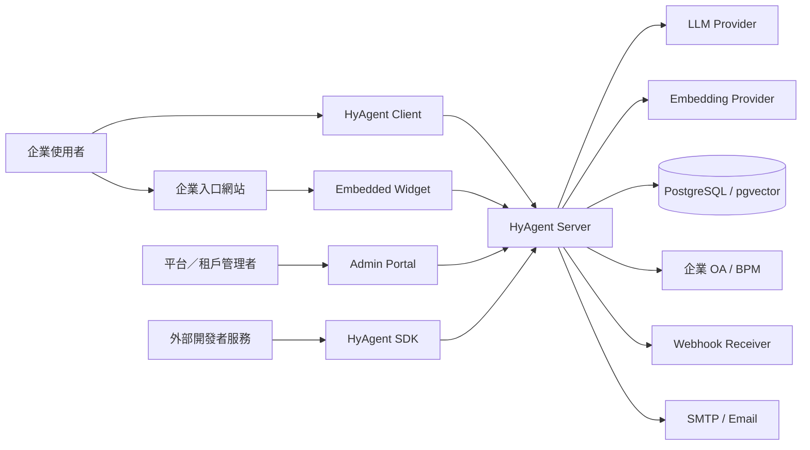

### 3.1 信任邊界

| 邊界                      | 信任原則                                                                     |
| ------------------------- | ---------------------------------------------------------------------------- |
| Browser → Server          | Browser 傳入的 User ID、Role、Scope 均不可信，必須由 Token／後端政策解析     |
| Host Site → Widget        | 通道本身不授權：授權來自**簽章**。Identity Assertion 走 `postMessage` 交付（雙向驗 origin 與 source），**憑證不得進 URL**——query string 會留在瀏覽器歷史、`Referer` 與存取日誌 |
| Tenant → Tenant           | `tenantId` 是硬隔離邊界，跨租戶資料查詢應回 404                              |
| LLM → Tool Executor       | 模型輸出的工具名稱與參數皆不可信，執行前需驗證 Schema、Scope 與狀態          |
| Server → External System  | 需設定 Timeout、錯誤映射、簽章、重試及必要的冪等機制                         |
| Admin Browser → Admin API | 使用短效 Admin JWT；主控 `ADMIN_API_KEY` 不得進入 Browser                    |

## 4. 系統架構

### 4.1 邏輯分層

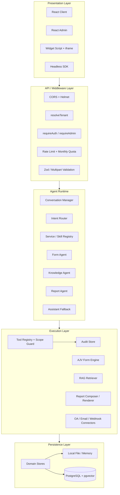

### 4.2 Monorepo 元件責任

| Workspace／目錄 | 責任                                                          |
| --------------- | ------------------------------------------------------------- |
| `client/`       | 第一方對話介面、嵌入 iframe、動態表單及報告下載               |
| `admin/`        | 租戶、外觀、權限、表單、知識庫、Webhook、用量、報告及稽核管理 |
| `server/`       | REST API、Agent Runtime、權限、資料儲存與外部連接器           |
| `schemas/`      | 內建表單的 Schema 單一事實來源                                |
| `shared/`       | 前後端共用 TypeScript 型別                                    |
| `ui/`           | 共用設計系統與展示元件                                        |
| `sdk/`          | Headless REST Client、Widget 控制與事件橋接                   |
| `presale/`      | Widget、自訂 UI 與 Webhook Receiver 整合範例                  |

## 5. 身分、租戶與帳號連結

### 5.1 身分的兩個正交維度

```text
Tenant identity：這次請求屬於哪個客戶／整合方
User identity：這次請求代表哪個終端使用者
```

| 維度   | 來源                                                      | 解析結果                                          |
| ------ | --------------------------------------------------------- | ------------------------------------------------- |
| Tenant | `x-api-key`、`Authorization: ApiKey` 或 Widget `?key=pk_` | `req.tenant`、`req.apiKeyType`                    |
| User   | `Authorization: Bearer <token>`：帳密登入為 JWT accessToken，嵌入路徑為不透明 `sessionToken`（`hyas_…`，查 auth session store） | `req.user.sub`、Role、登入方式與所屬租戶 |

未帶 API Key 時，`resolveTenant` 為向後相容會落到 Default Tenant。正式環境若不需要舊版相容，應評估取消此 Fail-open 行為。

### 5.2 API Key 類型

| 類型                  | 可放置位置              | 用途                                           | 儲存方式                                      |
| --------------------- | ----------------------- | ---------------------------------------------- | --------------------------------------------- |
| `pk_` Publishable Key | Browser、Widget Query   | 解析租戶、讀取 Widget 設定及呼叫一般使用者 API | 原始值只在建立時顯示，Store 保存 SHA-256 Hash |
| `sk_` Secret Key      | Server-to-server        | 租戶高權限自助設定，例如 BYO LLM Key           | 原始值只在建立時顯示，Store 保存 SHA-256 Hash |
| `ADMIN_API_KEY`       | Server-to-server Header | 平台管理 API                                   | Deployment Secret                             |

### 5.3 帳密登入

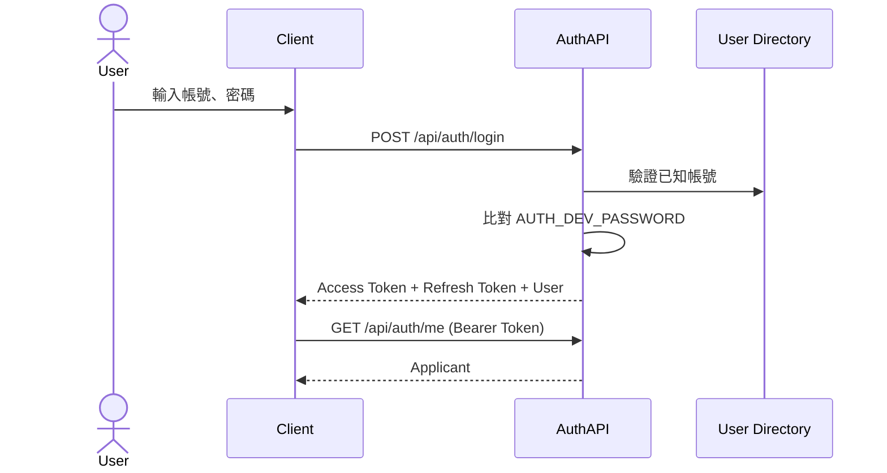

現況為 Mock User Directory 加共用開發密碼，不是正式企業身分來源。

### 5.4 SSO Handoff 與帳號連結

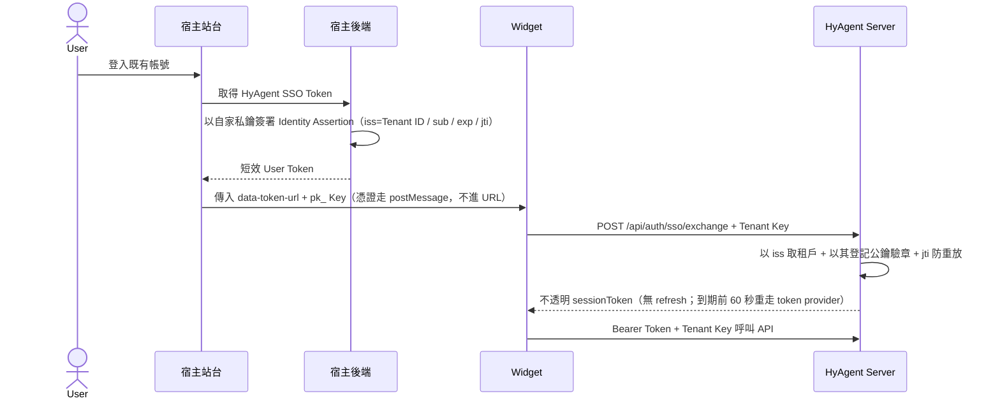

目前的帳號連結採「外部 `sub` 直接作為 HyAgent `userId`」的輕量模型，尚無獨立 `account_links` 資料表。這代表不同身分提供者或同一 `sub` 在不同租戶的唯一性，需依 `tenantId + userId` 組合判斷。

### 5.5 Tenant 一致性（已實作）

**此節原為 P0 缺口，現已補上。** `requireAuth` 在解析出使用者身分後統一比對：

```text
req.user.tenantId === req.tenant.id   // 不一致 → 401 'Token tenant mismatch'
```

現行行為：

1. 帳密登入 Token 綁 Default／First-party Tenant，拿它搭別的租戶金鑰會被上式擋下。
2. 嵌入路徑的租戶來自 **Assertion 的 `iss`**（非 API Key，見 [SSO 契約](HANDOFF-SSO.md)），
   Session 紀錄該租戶；`pk_` 只影響外觀設定與 CORS，不參與身分判定。
3. 不一致回 `401 UNAUTHORIZED`（非原先規劃的 `403 TENANT_MISMATCH`），在 Rate Limit、
   Scope 解析與 Domain Service 之前就擋下。
4. Refresh Token 輪替保留相同 Tenant Claim；SSO 路徑已無 refresh token，
   續期改為重走一次 Assertion 簽發。

## 6. 授權模型

### 6.1 有效 Scope 計算

```text
Effective Scopes
  = BASE_SCOPES
  ∪ Tenant.grantedScopes
  ∪ Department direct scopes
  ∪ Account direct scopes
  ∪ Department bundle scopes
  ∪ Account bundle scopes
```

解析輸入為 `{ tenantId, userId }`；Department 目前由內建 User Directory 取得，正式部署應改由可信任的 HR／Identity Attribute 提供。

### 6.2 Scope 類型

| 類型            | 範例                                                                   | 說明                                   |
| --------------- | ---------------------------------------------------------------------- | -------------------------------------- |
| Base Scope      | `oa:read`、`oa:write`                                                  | 目前所有使用者預設擁有，不可由後台取消 |
| Service Scope   | `service:form`、`service:knowledge`、`service:agent`、`service:report` | 控制 Agent Service 是否可用            |
| Tool Scope      | `email:write`、`calendar:read`、`erp:read`                             | 控制個別工具執行能力                   |
| Form Scope      | `form:leave-request`                                                   | 控制特定表單是否可用                   |
| Knowledge Scope | `kb:finance`                                                           | 控制具該可見性標籤的文件是否可被檢索   |

`service:report` 成本較高，不在新租戶預設 Service Scope 中，需管理者明確授予。

### 6.3 授權判斷鏈

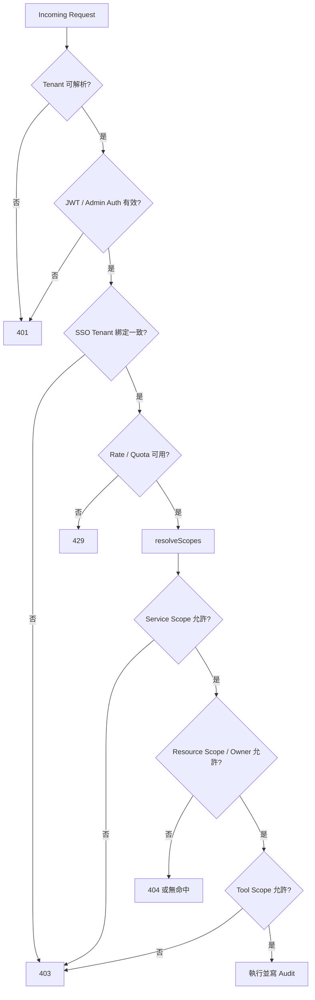

圖中的 SSO Tenant Binding 已由 `requireAuth` 統一實作（見 §5.5），所有掛 `requireAuth` 的路由一體適用。

### 6.4 知識庫 ACL

每個知識檔案可帶 `visibilityScopes`：

- 空 Scope：依 Knowledge ACL 模式與既定政策決定是否為公開／未標記資料。
- `kb:<labelId>`：使用者有效 Scope 必須至少符合檔案要求。
- Tenant 層禁止直接授予 `kb:*`，避免公開 Widget 或租戶所有人意外獲得敏感知識。
- `kb:*` 僅能配置到 Department、Account 或其 Bundle。
- ACL 過濾必須在 Retriever 與結構化 Table Catalog 內執行，而不是在 LLM 生成後刪文字。
- 被 ACL 阻擋的文件不應出現在回答、報告、圖表或一般使用者的錯誤訊息中。

### 6.5 RBAC、Scope 與 ACL 的對應

目前系統沒有獨立 Role Table；實作較接近以 Department／Account／Bundle 配置 Scope 的 ABAC/RBAC 混合模型：

```text
角色／部門語意 → Group Policy / Bundle
帳號例外       → Account Policy / Bundle
功能授權       → service:* / tool:* / form:*
資源授權       → kb:* + Owner Check
```

## 7. Agent Runtime 分析

### 7.1 Service Registry

| Service         | Scope               | 責任                                              |
| --------------- | ------------------- | ------------------------------------------------- |
| Form Agent      | `service:form`      | 表單選擇、Slot Filling、驗證、確認與送出          |
| Knowledge Agent | `service:knowledge` | RAG 問答                                          |
| Agent Service   | `service:agent`     | 多工具代理工作                                    |
| Report Agent    | `service:report`    | 建立非同步知識報告                                |
| Assistant       | Always enabled      | 一般回覆與安全 Fallback，不代表可繞過其他服務權限 |

### 7.2 意圖分流

1. 取得該 Tenant／User 可用 Service 清單。
2. 已建立且具有 Sticky Service 的 Session 優先沿用。
3. 使用 Keywords 與分類模型識別可能意圖。
4. 只在已授權 Service 中選擇路由。
5. 無適合 Service 時進入 Assistant Fallback。

### 7.3 Tool Executor

工具呼叫必須經 `toolRegistry.invoke`：

1. 由 `{ tenantId, userId }` 重新建立 Tool Context。
2. 解析有效 Scope。
3. 比對工具宣告的必要 Scope。
4. 驗證輸入並呼叫 Connector／Domain Service。
5. 無論成功或失敗皆留下必要 Audit 摘要。

LLM 不得直接呼叫資料庫或外部 OA。

## 8. 對話式表單分析

### 8.1 表單 Definition

| 層         | 系統消費者                                        |
| ---------- | ------------------------------------------------- |
| Data       | AJV 驗證、LLM Tool Input、OA Payload 基礎         |
| Field      | Client 元件 Registry、Label、Options、Help、Links |
| Validation | 必填、條件及跨欄規則                              |
| Agent      | 詢問順序、Prompt、確認話術與意圖詞                |
| Layout     | 表單分組、順序及多步驟 UI                         |
| Workflow   | 簽核關卡與狀態展示                                |
| Policy     | 請假時數等領域規則                                |
| OA         | Connector Endpoint、欄位映射及回應解析            |

### 8.2 填寫表單 Sequence

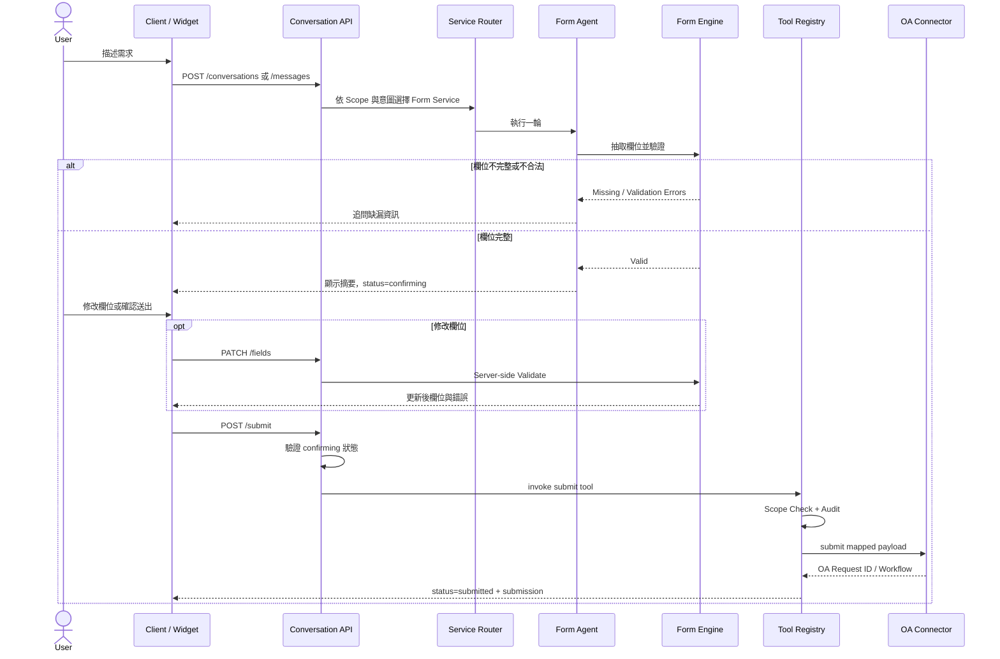

### 8.3 送出不變條件

- Session 的 Tenant、User、Form 不可由 Request Body 覆寫。
- `submit` 前 Session 必須已達 `confirming`。
- 使用者按下確認後由獨立 `/submit` 執行，不依賴 LLM 判斷「確認」文字。
- 修改欄位後需重新通過完整驗證；若破壞完整性，狀態需回到收集／修正流程。
- 明確同意欄位必須為 `true`，不得由 Agent 自動填入。
- OA 送出與 Webhook 應考慮同一 Session 重送的冪等需求。

### 8.4 附件流程

- Endpoint：`POST /api/conversations/:id/attachments`，Multipart Field 為 `file`。
- 單檔上限：10 MB。
- 上傳前先確認 Session Tenant／Owner。
- 儲存內容與 Metadata，表單值只引用 Metadata。
- 刪除附件同樣需 Session Owner Check。
- 正式大量使用時建議改接 Object Storage、病毒掃描及檔案類型白名單。

## 9. 知識庫分析

### 9.1 匯入流程

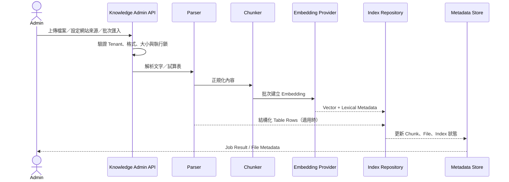

### 9.2 儲存與檢索後端

| 模式   | Index                                           | Retrieval                                            |
| ------ | ----------------------------------------------- | ---------------------------------------------------- |
| `file` | `knowledge-index.<tenantId>.json`               | 載入記憶體後以 JavaScript 計算 Cosine                |
| `db`   | PostgreSQL `knowledge_chunks` + `halfvec(3072)` | pgvector 精確 Dense Search 與 Lexical Candidate 聯集 |

目前資料量下刻意不使用 HNSW ANN，避免 Tenant Post-filter 造成小租戶無結果。單一租戶資料達十萬級 Chunks 時，才應以 Tenant Partition 或 Partial Index 重新評估 ANN。

### 9.3 查詢流程

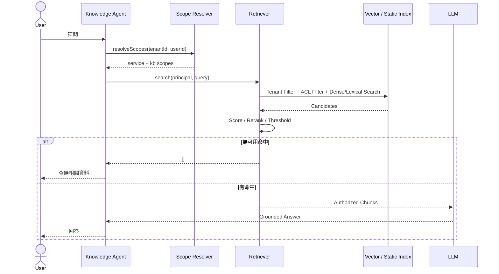

### 9.4 ACL 管理一致性

- Label ID 僅允許小寫英數與連字號。
- 刪除 Label 時需從 Department／Account Direct Scopes 及 Bundle Definition 中撤銷對應 Scope。
- 同名 Label 重建不得使舊的孤兒授權靜默復活。
- 文件重建索引時，既有 Visibility Scopes 應保留。
- ACL Report 與 As-user Query Test 應使用與正式 Retriever 相同的 Scope 邏輯。

## 10. 報告系統分析

### 10.1 建立與產出流程

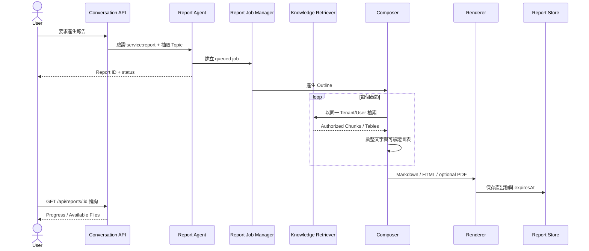

### 10.2 狀態與約束

| 狀態        | 意義                         |
| ----------- | ---------------------------- |
| `queued`    | 已排入工作                   |
| `outlining` | 正在產生章節大綱             |
| `composing` | 正在檢索、撰寫與渲染         |
| `done`      | 所有登錄格式已完成           |
| `empty`     | 全部章節均無資料，不建立檔案 |
| `failed`    | 工作失敗                     |

約束：

- 同一 Tenant 同時只允許一個 Report Job。
- 每章獨立檢索，不共享未驗證內容。
- 精確圖表的數值由程式從結構化表格計算。
- 綜合觀察只使用足量的精確圖表資料點。
- PDF 僅在啟動時偵測到 Chromium 才註冊。
- Renderer 未全部完成前保持 `composing`，避免前端過早停止輪詢。
- User API 以 Tenant + Owner 驗證；Admin 跨使用者下載必須 Audit。
- 產出物預設 TTL 為 720 小時。

## 11. 外部整合分析

### 11.1 Widget

- `/sdk/widget.js` 建立 iframe 並以 `?key=pk_` 傳遞 Publishable Key。
- 支援 Form、Locale、Theme、Position、User Token 等參數。
- Widget Config 為公開 Endpoint，但只應回外觀、服務開關與可公開建議問題。
- 事件以命名事件回傳宿主，例如送出完成。
- `postMessage` 接收方必須檢查精確 Origin 與 Message Shape。

### 11.2 SDK

- Headless Client 統一處理 API Base、API Key、Token 與錯誤格式。
- 提供 Widget `open`、`close`、`toggle` 與事件橋接。
- SDK 不應保存 `sk_` 或 `ADMIN_API_KEY` 於 Browser。

### 11.3 Webhook

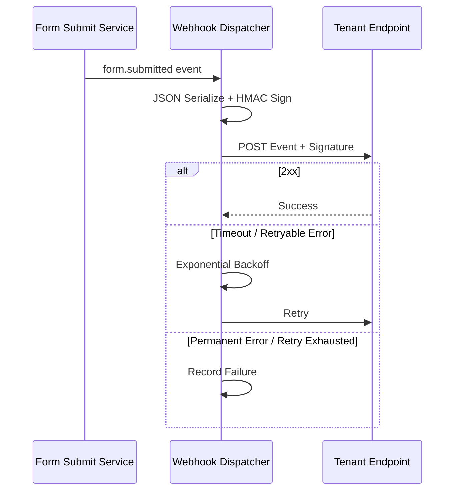

整合方應以 Raw Body 驗證 HMAC、檢查 Timestamp 防重放，並以 Event ID 實作冪等。現況若尚未提供 Event ID／Timestamp，應列入正式整合補強。

### 11.4 OA Connector

| 模式 | 用途                          | 現況                   |
| ---- | ----------------------------- | ---------------------- |
| Stub | Demo 送單、額度與計時模擬簽核 | 已實作                 |
| HTTP | 正式 OA 送單、查詢及簽核      | 有骨架，待取得外部規格 |

HTTP Connector 正式化需定義：認證方式、Timeout、Retry、冪等鍵、欄位 Mapping、錯誤碼 Mapping、附件傳輸及簽核狀態同步。

### 11.5 BYO LLM

- 只允許 `sk_` 呼叫租戶 LLM Config API。
- Provider 支援 Anthropic／OpenAI；Local Provider 為平台環境設定。
- 新 Key 儲存前需呼叫 Provider 驗證。
- 回讀 Key 只顯示遮罩。
- 租戶指定 Provider 後，該租戶所有相關 AI 呼叫應一致使用該設定。
- 租戶 Key 失效時回明確 502，不可靜默改用平台 Key。

## 12. 資料模型

### 12.1 核心關聯

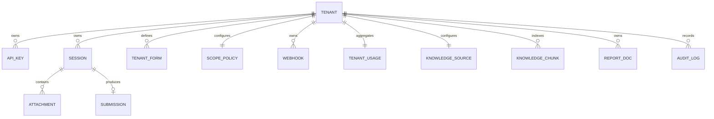

### 12.2 實體與識別鍵

| 實體             | 主鍵／識別               | 隔離與生命週期                               |
| ---------------- | ------------------------ | -------------------------------------------- |
| Tenant           | `id`                     | 平台層建立；刪除需清理所有租戶資源           |
| API Key          | Key Hash                 | 屬於 Tenant；可撤銷；原始值不落地            |
| Session          | `id`                     | 以 `tenantId + userId` 做 Owner Check        |
| Attachment       | `id`                     | 綁 Session；Session 清理時回收孤兒           |
| Submission       | `tenantId + oaRequestId` | 保存送出結果與 User                          |
| Tenant Form      | `tenantId + formId`      | 租戶 Definition 覆寫／擴充                   |
| Scope Policy     | `tenantId`               | 整包 Policy 覆寫                             |
| Knowledge Source | `tenantId`               | 保存來源、Index Meta、Files、Labels 相關狀態 |
| Knowledge Chunk  | Tenant-scoped ID         | 向量、文字、來源及 Visibility Metadata       |
| Webhook          | `id`                     | 屬於 Tenant，可停用或刪除                    |
| Report Doc       | `reportId + format`      | Tenant + User Owner，依 `expiresAt` 過期     |
| Audit Log        | Auto ID                  | Tenant-scoped、Append-oriented               |

### 12.3 Account Link 現況

目前沒有獨立 Account Link Entity；SSO 的 `{ tenantId, sub }` 即為外部身分對應。若未來同一使用者需連結多個 IdP、允許改帳號、合併歷史或解除綁定，應新增：

```text
AccountLink
- tenantId
- provider
- issuer
- externalSubject
- internalUserId
- status
- linkedAt
- unlinkedAt
Unique(tenantId, issuer, externalSubject)
```

## 13. API 與錯誤契約

### 13.1 Middleware 順序

一般對話 API 的預期順序：

```text
Helmet / CORS
→ JSON Parser / Request Logger
→ resolveTenant
→ requireAuth
→ tenant-user binding（待補）
→ tenantRateLimit
→ tenantMonthlyQuota（對話路徑）
→ Request Validation
→ Controller
→ Domain Service
→ Error Handler
```

### 13.2 統一成功格式

```json
{
  "data": {}
}
```

### 13.3 統一錯誤格式

```json
{
  "error": {
    "code": "BAD_REQUEST",
    "message": "可供使用者或開發者理解的訊息",
    "details": {}
  }
}
```

### 13.4 HTTP 狀態原則

| Status | 適用情境                                              |
| ------ | ----------------------------------------------------- |
| 400    | 業務輸入錯誤、不可授予 Scope、狀態不允許操作          |
| 401    | 缺少／無效／過期 Token 或 API Key                     |
| 403    | 已識別但權限不足、Key 類型錯誤、Tenant Binding 不一致 |
| 404    | 路由不存在、資源不存在或跨 Tenant／Owner 隔離         |
| 409    | 工作衝突、重複資源或同 Tenant Report Job 執行中       |
| 413    | 上傳超過大小限制                                      |
| 422    | Request Schema、檔案內容或指定輸出格式無法處理        |
| 429    | Rate Limit 或配額超限                                 |
| 502    | LLM／OA 等上游服務錯誤或租戶 Provider Key 失效        |
| 503    | 必要外部依賴尚未 Ready                                |
| 500    | 未預期內部錯誤；正式環境不得回傳 Stack 或敏感細節     |

### 13.5 冪等要求

目前需優先明確化的寫入操作：

- 表單送出：同一 Session 重試不得建立重複 OA 單據。
- Webhook Receiver：同一 Event 重送不得重複執行下游副作用。
- Knowledge Ingest：相同 Job／File 重試需保證 Index 與 Metadata 一致。
- API Key 建立：原始 Key 只顯示一次，Client 不應因網路重試產生多把未記錄 Key。

## 14. 持久化與一致性

### 14.1 File 模式

- 適用本機開發、單實例 Demo 與無 DB 情境。
- 部分 Store 使用記憶體加 JSON File。
- 不支援多實例一致性；部分 Job／Report 狀態重啟後遺失。
- 不應作為正式高可用部署的主要模式。

### 14.2 DB 模式

- 使用 PostgreSQL／Supabase 與 Prisma。
- Knowledge Vector 使用 pgvector `halfvec(3072)` 與 Raw SQL。
- Store 多採記憶體讀取加 Write-through Queue；啟動前需完成 Restore。
- Write Queue 失敗需監控，避免 API 已回成功但非同步落地失敗。
- Database Migration 由 `server/db/migrations/` 管理，Prisma Schema 主要作 Client 型別來源。

### 14.3 敏感資料

- API Key 以 SHA-256 Hash 儲存。
- BYO LLM Key 與 HyAgent Session 上的使用者識別碼（`sub`）在設定 `DATA_ENCRYPTION_KEY` 時以靜態加密落地。
  （SSO 共享密鑰已隨非對稱改造移除——現在存的是租戶**公鑰**，公開資料，不需加密。）
- 正式環境必須設定 Encryption Key，並建立 Key Rotation／備份復原程序。
- Log、Audit Summary 與錯誤 Details 不得包含 Token、Secret、完整 Prompt 敏感資料或附件內容。

## 15. 非功能系統設計

### 15.1 可用性

- `/healthz`：程序存活，不執行昂貴外部呼叫。
- `/readyz`：檢查 DB 等必要依賴；不可用時回 503。
- LLM、Embedding、OA、Webhook 呼叫應設 Timeout。
- 非關鍵 Webhook 失敗不得回滾已完成的 OA 送單。

### 15.2 效能與容量

- Rate Limit Key 為 `tenantId:userId`，避免單一使用者耗盡整個 Tenant 額度。
- Conversation 路徑另套 Monthly Quota。
- Embedding 採 Batch，避免逐 Chunk 遠端呼叫。
- Report 以背景 Job 執行並限制同 Tenant 併發。
- Attachment 單檔限制 10 MB。
- pgvector 目前採精確掃描；單 Tenant 超過約十萬 Chunks 時重新容量測試。

### 15.3 可觀測性

- Request Logger 產生 Request ID 並記錄必要請求資訊。
- 未處理錯誤以結構化 Logger 記錄。
- Tool Invocation 與 Admin 敏感操作進 Audit Store。
- 建議 Metrics：Latency、5xx、429、LLM Token、Ingest Duration、Report Duration、Webhook Retry、DB Queue Failure。
- 建議 Trace 關聯：Request ID、Tenant ID、User ID、Conversation ID、Job ID、Webhook Event ID。

### 15.4 國際化與時間

- 主要語言為繁體中文，Client 支援 Locale 切換及租戶預設語言。
- Report 顯示時區由 `REPORT_TIMEZONE` 控制，預設 `Asia/Taipei`。
- DB 時間建議使用 UTC，顯示層再轉換。

## 16. 部署分析

### 16.1 Zeabur 拓撲

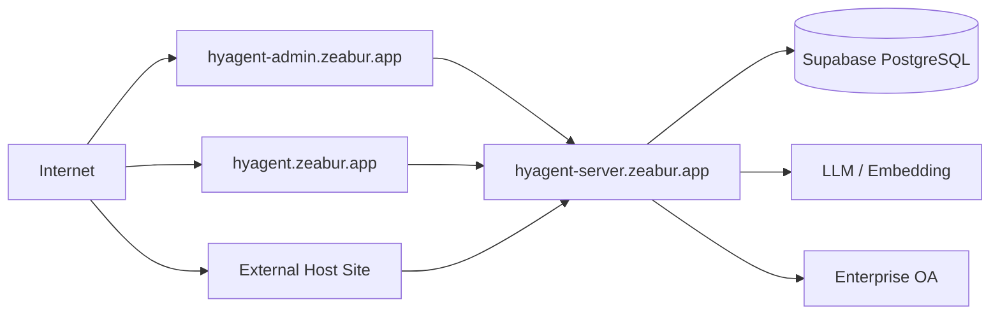

### 16.2 CORS

允許來源為：

```text
First-party CORS_ORIGIN
∪ 任一 Tenant.allowedOrigins
```

部署範例：

```env
CORS_ORIGIN=https://hyagent.zeabur.app,https://hyagent-admin.zeabur.app
```

注意事項：

- 網址需含 Scheme，結尾不加 `/`。
- CORS Middleware 必須在 Router 與 Error Handler 之前。
- 若 Zeabur Proxy 在 Express 前回 413／502／504，回應可能沒有應用層 CORS Header，Browser 會誤顯示為 CORS 問題；應同時檢查實際 Network Status 與 Proxy Log。
- 外部 Widget Site 除全域 CORS 外，還需在對應 Tenant `allowedOrigins` 中明確允許。

## 17. 安全威脅與控制

| 威脅                  | 現有控制                             | 缺口／建議                                                             |
| --------------------- | ------------------------------------ | ---------------------------------------------------------------------- |
| 偽造 User ID          | User ID 取自 JWT `sub`               | 移除 Controller 的 `x-user-id` 測試 Fallback 死碼，避免未來誤掛路由    |
| 跨租戶 Token 重用     | `requireAuth` 比對 Token 租戶與 API Key 租戶，不一致回 401；資源另以 Tenant + User 查詢 | 已補（§5.5）。新增路由時勿繞過 `requireAuth`                           |
| 公開 Widget 讀敏感 KB | Tenant 層禁止授予 `kb:*`             | 正式環境停用 Default Tenant `*` Origin，持續測試 Guest Department      |
| API Key 洩漏          | `pk_`／`sk_` 分級，Store 僅存 Hash   | Key Rotation、Last-used、IP／用途限制可列後續                          |
| Secret 落地外洩       | 可設定靜態加密                       | Production Fail-fast 要求 `DATA_ENCRYPTION_KEY`，建立 Rotation Runbook |
| LLM 越權呼叫工具      | Tool Registry 重新解析 Scope + Audit | 所有新 Tool 必須強制經 Registry，不允許旁路 Connector                  |
| Prompt Injection      | 只將授權 Chunks 送入 LLM             | 加入內容／指令邊界、輸出驗證及攻擊測試                                 |
| 重複送單              | Confirming 狀態 Guard                | 增加 OA Idempotency Key 與提交鎖                                       |
| Webhook 偽造／重放    | HMAC 簽章                            | 增加 Timestamp、Event ID、Tolerance 與 Receiver 冪等說明               |
| SSRF                  | PDF Renderer 列印時封鎖網路          | 網站擷取來源與 Webhook URL 仍需 URL／Private IP Policy                 |
| 惡意附件              | 大小限制                             | 增加 MIME／副檔名白名單、AV Scan、隔離下載                             |

## 18. 現況缺口與優先級

| 優先級 | 項目                                | 影響                                   | 建議完成條件                                                |
| ------ | ----------------------------------- | -------------------------------------- | ----------------------------------------------------------- |
| ✅ 已完成 | SSO Token 與 API Key Tenant Binding | 可能使跨 Tenant 身分被重用             | `requireAuth` 統一比對並回 401，端點測試已涵蓋              |
| P0     | 正式 Identity Provider（帳密路徑）  | Mock Directory／共用密碼不適合正式環境 | 嵌入路徑已由整合方自家登入承接（Identity Assertion，含停權與登出）；待補的是 HyAgent 自家帳密登入，正式環境預設關閉（`AUTH_PASSWORD_LOGIN=auto`），上線前需接 OIDC／企業 SSO 與 Claim Mapping |
| P0     | 真 OA Connector 的冪等與錯誤契約    | 可能重複送單或無法判斷結果             | 定義 Idempotency Key、Timeout、Retry、Mapping 與 E2E 測試   |
| P1     | Webhook 防重放與持久化 Queue        | 重啟或長時間故障可能遺失通知           | Event ID、Timestamp、持久化重試與 Dead-letter               |
| P1     | Report Job 持久化                   | 重啟後工作狀態遺失                     | Job 狀態、租戶鎖與恢復流程落 DB                             |
| P1     | Production Encryption Fail-fast     | Secret 可能明文落地                    | Production 未設 Encryption Key 時拒絕啟動或明確告警阻擋     |
| P1     | Attachment 安全與 Object Storage    | DB 膨脹、惡意檔案                      | S3／R2、AV Scan、Signed URL 與 Retention                    |
| P2     | Account Link Entity                 | 多 IdP／帳號合併無法管理               | 建立 Issuer + Subject 映射與解除綁定流程                    |
| P2     | 跨對話 Memory                       | 使用者需重複提供偏好                   | 有明確回訪需求後再建立 User Memory 與刪除控制               |
| P2     | Retrieval ANN                       | 大規模 Tenant 查詢延遲                 | Tenant 達容量門檻後，以 Partition／Partial Index 驗證召回率 |

## 19. 測試策略與系統驗收

### 19.1 測試層次

| 層次        | 重點                                                                           |
| ----------- | ------------------------------------------------------------------------------ |
| Unit        | Schema Engine、Scope Resolver、ACL、Scoring、Mapping、State Guard              |
| Integration | Route + Middleware + Store、DB Repository、Provider Stub、Webhook Retry        |
| Security    | Cross-tenant、Owner Check、Guest Scope、Tenant Binding、Secret Redaction、SSRF |
| Contract    | OA、Webhook、LLM Provider、Embedding、SDK 與 OpenAPI                           |
| E2E         | Login／SSO → Conversation → Confirm → Submit → Webhook／Report                 |
| Deployment  | CORS、Health、Ready、Migration、Restart Recovery、PDF Renderer                 |

### 19.2 必要系統驗收案例

1. `pk_`、`sk_`、Admin JWT 與 Admin Key 的權限不能互相越級。
2. Tenant A 的 Session、Attachment、Knowledge、Report 與 Submission 不得被 Tenant B 讀取。
3. Tenant A 簽發的 SSO Token 搭配 Tenant B API Key 必須回 403。
4. Department 與 Account Scope 聯集正確，未授權 Service 不得被 Intent Router 選中。
5. Tenant 層配置 `kb:*` 必須被拒絕。
6. ACL 文件不出現在未授權者的 Query、Report、Table Catalog 或圖表。
7. 表單未達 Confirming、資料驗證失敗或未明確同意時不得送 OA。
8. 同一 Session 重複 Submit 不得建立兩張正式 OA 單。
9. Report 全章無資料時為 `empty` 且沒有下載檔案。
10. Webhook 簽章錯誤、重放與重試耗盡均有可觀測結果。
11. Production 錯誤回應不得曝露 Stack、Token、Provider Key 或 Database Detail。
12. Proxy 413／502／504 與應用層 CORS 錯誤能在監控上被區分。

## 20. 需求追蹤矩陣

| 產品能力     | 系統元件                                     | 主要資料                     | 主要驗證                                  |
| ------------ | -------------------------------------------- | ---------------------------- | ----------------------------------------- |
| 帳號登入     | Auth Routes／Service、JWT Utils              | User Directory、Token        | 401、Refresh Rotation、停權               |
| SSO 帳號連結 | SSO Exchange、Assertion Verifier、Tenant 公鑰 | Tenant、Assertion Claims     | Signature、Expiry、jti 防重放、Tenant Binding |
| 對話填寫表單 | Conversation、Form Agent、Form Engine        | Session、Definition          | Owner、Scope、State、Schema               |
| 表單送出     | Tool Registry、Submit Registry、OA Connector | Submission、Audit            | Confirm、Idempotency、Tool Scope          |
| 知識問答     | Knowledge Agent、Retriever                   | Chunks、Labels、Scope Policy | Tenant Filter、ACL、Threshold             |
| 報告         | Report Agent、Job、Composer、Renderer        | Report Job／Docs             | Service Scope、Owner、TTL                 |
| 租戶管理     | Admin API／Portal                            | Tenant、API Keys             | Admin Auth、Secret Redaction              |
| 權限管理     | Scope Catalog／Policy／Resolver              | Scope Policy、Bundle         | Grantable Validation、No `kb:*` at Tenant |
| 外部嵌入     | Widget、Config API、CORS                     | Appearance、Allowed Origins  | Origin、Publishable Key、SSO              |
| 事件回拋     | Webhook Dispatcher                           | Endpoint、Audit／Delivery    | HMAC、Retry、Idempotency                  |
| 用量治理     | Usage、Rate Limit、Quota                     | Tenant Usage                 | Tenant/User Key、429                      |
| 營運稽核     | Logger、Audit Store                          | Audit Log                    | Tenant Filter、Sensitive Data Redaction   |

## 21. 待決議事項

1. 正式身分來源採 OIDC、既有 Portal Token Exchange，或兩者並存？
2. Password Login 是否只允許第一方 Default Tenant，還是需可指定 Tenant？
3. SSO `sub` 是否在單一 Tenant 內永不改變？是否需保存 `iss`／`provider`？
4. Department 與 Role Claim 的可信來源、同步頻率及停權 SLA 為何？
5. `oa:write` 是否應繼續作為所有人的 Base Scope？正式環境建議改為可授予權限。
6. 未標記知識檔案在 ACL 啟用時應視為公開、內部公開或管理者限定？
7. OA Submit 的 Idempotency Key 與「已送出但回應 Timeout」如何查核？
8. Webhook 的 Event Schema、Version、Timestamp、Event ID 與重試上限為何？
9. 對話、附件、稽核、知識與報告的法規／企業 Retention Policy 為何？
10. Production 是否強制 DB Backend、Encryption Key 與明確 CORS 白名單？

## 22. 參考資料

- [`PRODUCT_SPEC.md`](PRODUCT_SPEC.md)：產品需求、角色與驗收基準。
- [`ARCHITECTURE.md`](ARCHITECTURE.md)：平台目標架構、現況及演進觸發點。
- [`../INTEGRATION.md`](../INTEGRATION.md)：多租戶、SSO、Widget、SDK 與 Webhook。
- [`../schemas/README.md`](../schemas/README.md)：表單 Schema 欄位級規格。
- [`../DEPLOY.zeabur.md`](../DEPLOY.zeabur.md)：Zeabur 部署與環境變數。
- `/api/openapi.json`：Machine-readable API Contract。
- `/api/docs`：Swagger UI。
