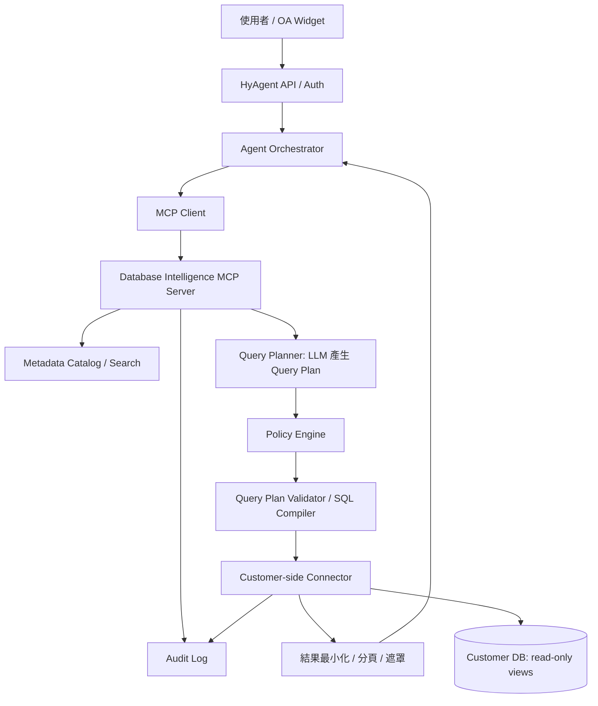

# HyAgent Database Intelligence — 開發規格書

> 版本：v0.1（MVP 實作基準）  
> 日期：2026-10-29  
> 狀態：Draft / 可供開發拆工  
> 目標：讓客戶接入既有關聯式資料庫，不必為每種自然語言查詢開發業務 API，即可在受控權限內探索資料並回答問題。

## 1. 目標與邊界

### 1.1 產品目標
- 客戶安裝 Customer-side Connector、設定資料庫唯讀連線及授權範圍。
- 系統自動擷取授權範圍內的 Schema、欄位、主外鍵與註解，建立 Metadata Catalog。
- 使用者以自然語言提問，HyAgent 找到相關 Metadata、產生結構化查詢計畫，經權限驗證後編譯與執行 SQL。
- 回傳必要且最小化的結果，並以自然語言說明，附查詢依據與限制。
- 同一組通用 MCP 工具可服務多個客戶；不要求每個查詢問題建立新 API。

### 1.2 MVP 支援
- 首個資料庫：PostgreSQL；架構預留 MySQL、SQL Server Adapter。
- 單一租戶可建立多個資料來源，但 MVP 每次查詢僅支援單一資料來源。
- SELECT 類型的安全聚合、篩選、排序、分頁；支援已確認的主外鍵 JOIN。
- 明確的資料表/欄位 Allowlist、使用者資料範圍政策、稽核紀錄。
- Metadata 自動擷取、AI 建議描述、人工審核重要語意。
- 不確定語意時拒答或要求確認，而非猜測。

### 1.3 非目標（MVP 不做）
- 任意 SQL 直接執行、DML/DDL、Stored Procedure、任意 SQL 函式。
- 任意跨資料庫 JOIN、跨客戶查詢、自動修改資料。
- 自動推斷所有業務關聯並視為真實；零審核的高風險資料查詢。
- 將整庫資料上傳 LLM 或向量資料庫。
- 完整 BI 語意層、排程報表、資料寫入 Agent。

## 2. 設計原則
1. **LLM 不直接連線資料庫**；LLM 輸出 Query Plan，不持有 SQL 執行權。
2. **資料存取權限由可信後端與資料庫強制執行**；不可採信 LLM 傳入的 tenantId/userId。
3. **預設拒絕（deny by default）**：沒有核准的資料集、欄位、關聯與操作就不可查詢。
4. **資料最小化**：在資料庫計算聚合，只傳必要結果給模型。
5. **Schema 是資料，不是指令**：資料表註解、樣本值、查詢結果均視為不可信輸入。
6. **可追溯**：每次查詢可追查誰、何時、使用何政策、查詢何種資料、是否成功。
7. **客戶側隔離**：優先讓 DB Credentials 留在客戶端 Connector，避免暴露正式資料庫到公網。

## 3. 系統架構



### 3.1 元件責任
| 元件 | 責任 | 部署建議 |
|---|---|---|
| HyAgent API | 驗證 Identity Assertion 換發的存取權杖；取得可信身分 | HyAgent 平台 |
| Agent Orchestrator | 解析問題、工具選擇、對話與答案生成 | HyAgent 平台 |
| Database Intelligence MCP Server | 通用工具介面與協調流程 | HyAgent 平台或客戶端 |
| Metadata Catalog | 儲存 Schema、關聯、業務描述、版本、敏感分類 | 按租戶隔離 |
| Query Planner | 將自然語言轉為受限 Query Plan | HyAgent 平台或客戶端 |
| Policy Engine | 授權判斷、資料範圍與輸出限制 | 可信服務端；執行前再次驗證 |
| SQL Compiler | 由核准的 AST/Query Plan 生成參數化 SQL | 客戶端優先 |
| Customer-side Connector | DB 連線、Schema 掃描、唯讀執行、資源限制 | 客戶網路內 |
| Audit Service | 查詢決策、指紋、耗時與結果筆數 | 受保護儲存 |

### 3.2 信任邊界
- 使用者 → HyAgent：必須驗證登入與 Session。
- HyAgent → Connector：mTLS 或等效強驗證、短效服務憑證；Connector 驗證簽章、受眾、租戶、期限及重放保護。
- Connector → DB：專用唯讀帳號，TLS，限制網路來源；最好使用唯讀 View/Replica。
- LLM：不可信決策來源；不得直接決定權限或執行任意 SQL。
- Metadata、資料列及錯誤訊息：不可信內容，需避免 Prompt Injection 與敏感資訊回傳。

## 4. 主要使用流程

### 4.1 客戶導入 / Onboarding
1. 管理員建立資料來源（tenant 綁定）。
2. 客戶端安裝 Connector；金鑰保留在客戶 Secret Manager，不上傳資料庫密碼到 HyAgent。
3. 使用唯讀 DB 帳號測試連線。
4. 掃描資料庫系統目錄，只取得管理員允許的 Schema/Table/View/Column。
5. 產生 Metadata Catalog，標記外鍵關聯與未確認的推論。
6. AI 建議欄位/資料表業務描述與敏感級別；由管理員核准重要描述與查詢範圍。
7. 發布 Metadata 版本，開始提供自然語言查詢。
8. Schema 變更時重新掃描、比較差異；新增欄位預設不開放。

### 4.2 自然語言查詢
1. 使用者提問，HyAgent 取得可信 tenant、user、roles 與權限上下文。
2. `search_schema` 在該使用者可見的 Metadata 範圍內搜尋相關表、欄位及關聯。
3. Planner 產生 JSON Query Plan；不產生可直接執行的任意 SQL。
4. Validator 檢查 JSON Schema、欄位、JOIN、運算子、聚合、分頁及限制。
5. Policy Engine 依使用者、租戶、資料分類及資料列範圍判斷是否允許。
6. Compiler 使用固定 SQL AST 模板及參數化值產生 SQL。
7. Connector 以唯讀交易、資源配額、逾時與結果上限執行；必要時使用 DB RLS/View 做第二道限制。
8. 對結果做遮罩與最小化後回傳 Agent；回答附上資料來源、篩選條件及必要的不確定性。
9. 記錄 Audit Event；拒絕時也要記錄原因代碼。

## 5. MCP Tool 規格（MVP）

> MCP 是工具協定，不代表每種問題都要定義一個 API。所有工具均由服務端根據認證上下文綁定租戶與使用者；LLM 不可自行指定。

| Tool | 輸入 | 輸出 | 注意事項 |
|---|---|---|---|
| `search_schema` | `question`, `data_source_id?`, `limit?` | 授權可見的 tables/columns/relationships | 過濾敏感 Schema；限制結果大小 |
| `get_dataset_details` | `dataset_id` | 欄位型別、核准描述、關聯、可用運算 | 不提供 DB Credentials |
| `plan_query` | `question`, `dataset_ids` | 結構化 Query Plan、歧義警告 | 可作內部工具，不一定暴露給 LLM |
| `execute_safe_query` | `query_plan`, `request_id` | `result_id`, `columns`, `rows`, `row_count`, `warnings` | 必須重驗權限、計算成本與結果上限 |
| `get_query_result` | `result_id`, `cursor?` | 授權分頁結果 | 結果快取須綁定 tenant/user/policy/version/TTL |

### 5.1 Query Plan 範例
```json
{
  "version": "1.0",
  "data_source_id": "ds_project_01",
  "dataset": "projects",
  "select": [
    { "field": "name" },
    { "field": "estimated_hours" },
    { "field": "actual_hours" }
  ],
  "filters": [
    { "field": "start_date", "op": "gte", "value": "2026-01-01" },
    { "field": "start_date", "op": "lt", "value": "2027-01-01" },
    { "expression": "actual_hours_over_estimated_ratio", "op": "gt", "value": 1.2 }
  ],
  "order_by": [{ "field": "name", "direction": "asc" }],
  "limit": 100
}
```

**重要：** `actual_hours_over_estimated_ratio` 是 Catalog 內**已核准**的計算欄位，不允許 LLM 直接送任意 SQL expression。若資料集沒有這個計算欄位，需拒絕或要求管理員先定義。日期「今年」必須根據查詢時區及已確認的業務日期欄位轉換。

### 5.2 API（建議 REST 管理端）
| Method | Path | 用途 |
|---|---|---|
| POST | `/api/data-sources` | 建立資料來源設定（不接收明文 DB 密碼） |
| POST | `/api/data-sources/{id}/connection-test` | 透過 Connector 測試連線 |
| POST | `/api/data-sources/{id}/schema-sync` | 執行 Metadata 掃描 |
| GET | `/api/data-sources/{id}/catalog` | 取得可管理的 Metadata |
| PATCH | `/api/catalog/datasets/{id}` | 核准描述、敏感級別與 Allowlist |
| POST | `/api/query/preview` | 查詢計畫預覽（不執行） |
| POST | `/api/query/execute` | 受控查詢執行 |
| GET | `/api/query/{requestId}/audit` | 查詢稽核資訊（限管理者） |

錯誤格式：
```json
{
  "request_id": "req_01",
  "error": {
    "code": "QUERY_POLICY_DENIED",
    "message": "此查詢超出可存取資料範圍",
    "retryable": false
  }
}
```

## 6. Metadata Catalog 資料模型

### 6.1 核心資料表
| Table | 關鍵欄位 | 用途 |
|---|---|---|
| `data_sources` | id, tenant_id, connector_id, db_type, status | 資料來源 |
| `catalog_datasets` | id, tenant_id, source_id, schema_name, object_name, description, approval_status, schema_version | 資料集 |
| `catalog_columns` | id, dataset_id, column_name, data_type, description, sensitivity, is_queryable | 欄位 |
| `catalog_relationships` | id, from_dataset, from_column, to_dataset, to_column, origin, approval_status | 關聯 |
| `catalog_metrics` | id, dataset_id, metric_key, definition_ast, approval_status | 核准指標 |
| `access_policies` | id, tenant_id, principal_selector, dataset_id, column_rules, row_scope, output_rules | 存取政策 |
| `query_audits` | request_id, tenant_id, principal_id, source_id, plan_hash, policy_version, status, row_count, duration_ms, created_at | 稽核 |

### 6.2 Metadata 建立規則
- 自動擷取：名稱、型別、nullable、PK、FK、index、comment。
- AI 推測：業務描述、同義詞、敏感程度；標記 `suggested` 與信心值。
- 人工核准：敏感資料集、業務指標、無 FK 的推論 JOIN。
- Schema 版本化：新增/變更欄位後，原授權不自動擴大。
- 不預設掃描真實資料列；如需樣本值，須獨立授權、遮罩與記錄。

## 7. 安全需求（不可延後）

### 7.1 資料庫層
- 專用唯讀帳號，只授權核准的 View/Schema；禁止 DDL/DML、管理函式、外部存取擴充功能。
- 優先用 DB RLS 或安全 View 落實列權限；應用層政策不可取代 DB 最小權限。
- 設定 statement timeout、connection pool 上限、唯讀 transaction、結果筆數與位元組上限。
- 針對重查詢限制並行數與成本；必要時查詢 Read Replica。
- 使用 TLS；Connector 到 DB 限定來源 IP/網段。

### 7.2 查詢層
- 嚴格 JSON Schema 驗證、欄位及運算子 Allowlist；不接受 SQL 字串作為執行輸入。
- 使用 SQL AST/Compiler 生成 SQL，值使用參數化綁定；識別字由 Catalog Allowlist 映射。
- 不支援任意函式、子查詢、UNION、CTE、跨資料來源 JOIN（MVP）。
- 執行前重新授權；不信任 AI 提供的 `tenant_id`、`user_id`、`role`、`department_id`。
- 設計推論攻擊防護：對敏感聚合設定最小群組大小、限制可反覆縮小條件的查詢；必要時拒答。

### 7.3 平台與資料傳輸
- Connector 以出站連線或受控通道接入，避免公開 DB Port。
- Connector 驗證 HyAgent 服務身分、租戶、request_id、時效與重放；傳輸加密。
- DB Credentials 存客戶 Secret Manager；不得出現在 Prompt、Metadata、Log。
- Tenant 分區覆蓋 Catalog、向量索引（若啟用）、快取、稽核與執行結果。
- LLM 僅收到核准 Metadata 與最小結果；客戶需能選擇雲端/地端模型及資料出境政策。
- 將資料庫欄位註解、內容及錯誤視為不可信輸入；不允許其改變系統指令或權限。
- Audit Log 避免存放敏感結果及完整密碼；保留期限由客戶政策設定。

### 7.4 MVP 威脅測試
| 測試 | 預期 |
|---|---|
| 一般員工詢問全公司薪資 | 拒絕，並留存稽核 |
| LLM Query Plan 指定另一租戶資料來源 | 服務端拒絕 |
| 欄位註解包含「忽略規則」 | 視為資料，不執行指令 |
| 非法欄位 / 未核准 JOIN | Validator 拒絕 |
| 嘗試 SQL 注入字串 | 參數化處理，不改變 SQL 結構 |
| 超大量資料/長時間查詢 | 截斷或逾時，避免拖垮正式 DB |
| Schema 新增敏感欄位 | 預設不可查，需審核 |
| 快取跨使用者讀取 | 拒絕 |

## 8. 推薦專案結構
```text
hyagent-database-intelligence/
├── apps/
│   ├── mcp-server/             # MCP tools / auth context / orchestration
│   ├── admin-console/          # 資料來源、Catalog、Policy 管理
│   └── customer-connector/     # 客戶端部署，DB adapter / executor
├── packages/
│   ├── contracts/              # JSON Schema / types / error codes
│   ├── catalog/                # metadata ingestion, versioning, search
│   ├── query-planner/          # NL -> constrained Query Plan
│   ├── policy-engine/          # tenant/user/column/row/output policy
│   ├── query-compiler/         # Query Plan -> parameterized SQL
│   ├── db-adapters/            # postgres first, mysql/mssql later
│   └── audit/                  # audit events
├── infra/
│   ├── migrations/
│   └── docker/
├── tests/
│   ├── unit/
│   ├── integration/
│   ├── security/
│   └── e2e/
└── docs/
    ├── architecture.md
    ├── api-contracts.md
    ├── security-model.md
    └── operations.md
```

> 技術可依現有 HyAgent 後端調整。建議 TypeScript/Node.js 實作 MCP 與管理 API；PostgreSQL 作為第一個 Adapter；Zod/JSON Schema 驗證 Query Plan；SQL AST Compiler 不使用字串拼接。此為建議，不是既有專案事實。

## 9. 實作順序與任務拆分

### Sprint 0：安全基礎與契約
- [ ] 定義 Tenant/User/Auth Context（與既有 Identity Assertion 串接）。
- [ ] 定義 Query Plan JSON Schema v1 與錯誤碼。
- [ ] 設計 Policy Engine 規則：資料集、欄位、資料列、輸出。
- [ ] 建立測試 PostgreSQL DB、敏感欄位與不同權限測試帳號。
- [ ] 完成威脅模型與資料流向盤點。

**驗收：** 未授權資料集、欄位、租戶、角色一律被拒絕。

### Sprint 1：Connector 與 Metadata
- [ ] PostgreSQL Adapter：連線測試、系統目錄掃描、FK 取得。
- [ ] Connector 安全通道與 DB Credential 管理。
- [ ] Catalog Migration、Schema Version、變更差異。
- [ ] Admin API：選擇 Allowlist、核准 Metadata。

**驗收：** 新增 DB 後可掃描並顯示授權 Schema；新增欄位不會自動開放。

### Sprint 2：查詢引擎
- [ ] Query Plan Validator（白名單運算子、聚合、排序、JOIN）。
- [ ] Policy Engine + 資料列限制。
- [ ] SQL Compiler（PostgreSQL 方言、參數化）。
- [ ] Query Executor（timeout、limit、read-only、結果遮罩）。
- [ ] Audit Logging。

**驗收：** 通過 7.4 所列全部安全測試，並能完成已核准資料集的查詢。

### Sprint 3：AI / MCP 整合
- [ ] MCP Tools：`search_schema`, `get_dataset_details`, `execute_safe_query`。
- [ ] Metadata 檢索與 Planner Prompt（JSON Schema 輸出）。
- [ ] 歧義處理與低信心拒答。
- [ ] 答案來源、過濾條件與查詢紀錄顯示。
- [ ] 端對端測試：自然語言 → Plan → Policy → SQL → Answer。

**驗收：** 使用者不需預先定義查詢 API，即可完成 10 個已核准的自然語言查詢案例。

### Sprint 4：穩定性與試點
- [ ] 指標：查詢成功率、拒絕率、p95 latency、DB query time、LLM token 成本。
- [ ] 測試 100+ tables 的 Metadata 檢索效能。
- [ ] 權限滲透測試、Prompt Injection 測試、負載測試。
- [ ] 客戶試點與人工驗證查詢正確率。

**驗收：** 無跨租戶/越權查詢；錯誤查詢可追溯；核心案例通過人工核對。

## 10. MVP Demo 驗收案例

測試資料集：`projects(id, name, department_id, estimated_hours, actual_hours, start_date)`、`departments(id, name)`，另建 `employee_salary` 作為禁止查詢資料集。

| 使用者問題 | 預期行為 |
|---|---|
| 今年有哪些專案？ | 篩選已核准日期欄位，回傳專案列表 |
| 哪些專案超時 20%？ | 使用已核准計算欄位，回傳專案及工時 |
| 各部門專案數量？ | 使用已核准 JOIN 與聚合 |
| 我的部門有哪些專案？ | 由可信 Auth Context 套用部門範圍 |
| 公司所有員工薪資？ | 拒絕 |
| 列出所有資料庫表？ | 僅回傳允許顯示的 Catalog |
| 專案完成率是多少？（無完成定義） | 提問澄清或回覆未定義，不猜測 |

## 11. 測試與品質門檻
- **Unit**：Validator/Compiler/Policy 針對合法與惡意 Query Plan 建立測試。
- **Integration**：真實 PostgreSQL 容器驗證 DB 最小權限、RLS/View、timeout、分頁。
- **Security**：跨租戶、權限提升、SQL 注入、Prompt Injection、Schema 洩漏、快取隔離。
- **Accuracy**：建立至少 30 個自然語言問答 Golden Cases，逐題比對人工核准 SQL 的結果。
- **Observability**：每次請求有 request_id、plan_hash、policy_version、catalog_version、execution metrics。
- **上線阻擋條件**：任何越權讀取、跨租戶資料洩漏、SQL 寫入或 DB Credentials 外洩均不得上線。

## 12. 尚待決策（開發前確認）
1. HyAgent 目前後端語言、框架及既有 MCP Client 位置。
2. Connector 是否必須支援完全地端模式；雲端模型是否允許接收查詢結果。
3. 第一版 DB 類型是否確定 PostgreSQL，或客戶實際主要使用 MSSQL。
4. 客戶權限來源：OA API、資料庫 RLS、既有 IAM 或 HyAgent Policy。
5. Metadata 是否允許採樣真實資料（建議預設否）。
6. Query Result Cache 的保存位置、TTL、遮罩與加密政策。
7. 客戶是否能提供核准 View / 業務指標，或需要 UI 協助建立。

## 13. 第一個可執行開發任務

**Task：建立 PostgreSQL Schema Discovery + Catalog MVP**

**輸入**：受限 PostgreSQL 唯讀連線、允許掃描的 Schema 名稱。  
**輸出**：結構化 JSON，包含 tables/views、columns、PK、FK、comments、schema_version。  
**限制**：不讀取資料列、不輸出憑證、不掃描未授權 Schema。  
**完成條件**：能掃描 Demo DB、寫入 Catalog、重掃後產生差異，且新增欄位維持 `is_queryable=false`。

建議先完成此任務，再開發 Query Planner；若沒有可信的 Metadata 與權限模型，Text-to-SQL 會難以安全落地。
