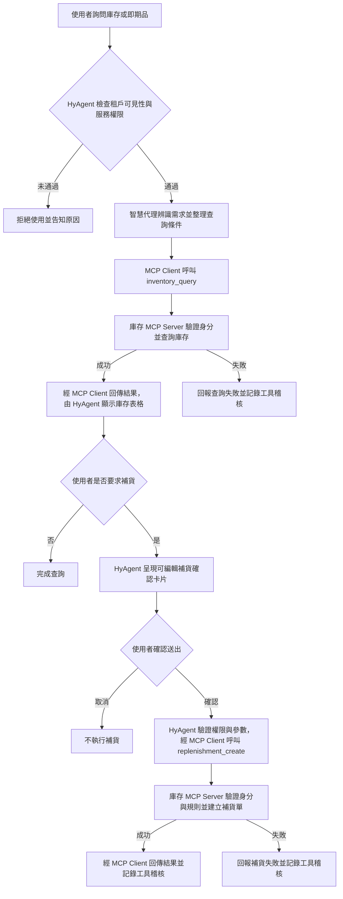
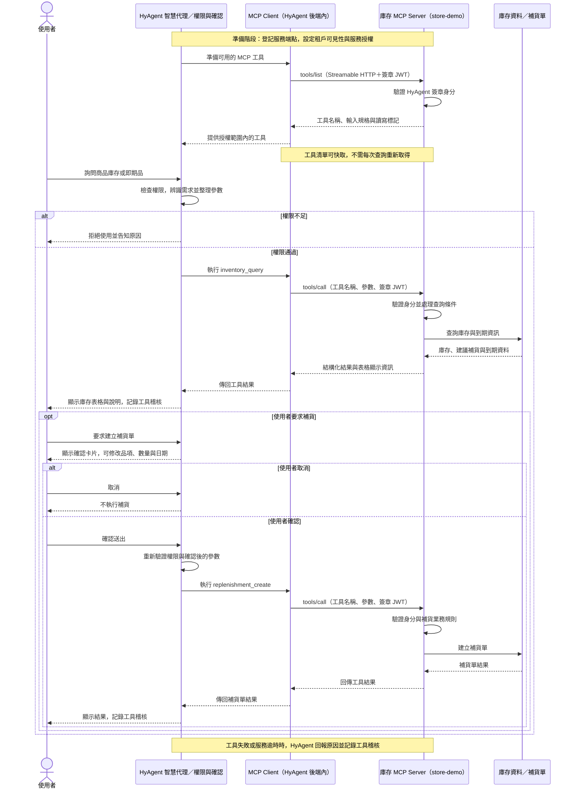

# 庫存 MCP 處理流程

若 Markdown 預覽未顯示 Mermaid，可直接開啟獨立圖片：[處理流程圖](庫存MCP處理流程圖.svg)、[Client / Server 互動時序圖](庫存MCP互動時序圖.svg)。

依現有 `store-demo` 實作，呈現庫存查詢及使用者選擇補貨後的處理流程。HyAgent 後端內的 MCP Client 負責取得工具清單、發送工具呼叫及接收結果；庫存 MCP Server 負責提供工具、驗證呼叫身分及執行庫存業務。庫存查詢為唯讀，不需操作確認；建立補貨單須先確認。

## 庫存查詢與補貨處理流程圖

## MCP Client 與 MCP Server 互動時序圖

HyAgent 每次 MCP HTTP 請求以短效 ES256 JWT 傳遞租戶、使用者與權限；使用者須具 `service:agent` 與 `mcp:store-demo` 權限。庫存查詢也納入工具稽核。

圖中的 MCP Client 是 HyAgent 後端模組，MCP Server 是獨立提供庫存工具的服務；瀏覽器與 AI 模型不直接連線至 MCP Server。資料節點表示服務端使用的業務資料，現有 Demo 並未串接正式庫存資料庫。

目前 `store-demo` 使用示範資料，補貨單儲存於記憶體，重啟後不保留；正式導入須串接企業庫存系統與持久化儲存。建立補貨單不代表已完成採購、到貨或庫存更新。
